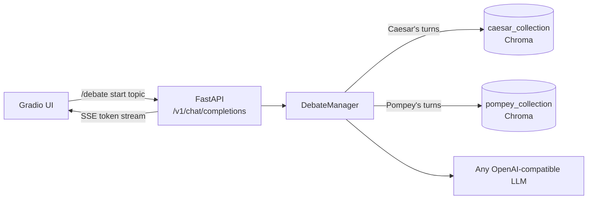

# Roman Senate

Two LLM agents, Caesar and Pompey, debate a topic you give them. Each one retrieves only from his own set of ancient sources and backs factual claims with numbered citations to them.

Pick a topic like "Rubicon legality" or "Should Rome build more aqueducts?" and they argue it turn by turn in the browser.

## How it works



Each turn goes like this:

1. The search query is the topic plus the first ~200 characters of the opponent's last turn. Embedding a whole speech dilutes the query.
2. Retrieval runs on the speaker's own collection only. It fetches 2×k candidates, drops chunks past a distance cutoff, drops duplicates and caps how many chunks can come from one file, so a single long book can't fill the whole context.
3. The request is built from the speaker's point of view: his own past turns are `assistant` messages, the opponent's are `user` messages. Retrieved chunks go into the last user message as numbered `<document>` blocks, so the system prompt (character and debate rules) stays the same on every turn.
4. Tokens are streamed back over SSE. The backend mixes in a few control markers (`[START:Caesar]`, `[END_TURN]`, `[DEBATE_DONE]`) so the UI knows where one speech ends and the next begins.

The prompts ask for `[n]` citations on concrete factual claims and for "Not supported by sources." when nothing backs a claim. Each turn is written to `logs/debate.log` together with the chunks the model was given, which makes it easy to check whether a citation matches its source.

The backend uses the OpenAI chat completions format, so a debate can also be started and streamed with curl or any OpenAI client. Speaker changes then show up as the plain-text markers above. The model provider is just configuration: chat and embeddings can come from OpenAI, vLLM, Ollama, LM Studio, NVIDIA NIM or llama.cpp, and from two different servers if needed.

Footnote and page markers like `[56]` or `[p. 12]` are stripped from the source texts before indexing, because the model would otherwise read them as citations.

## Running it

You need an OpenAI API key, or any OpenAI-compatible server for chat and embeddings.

```bash
cp .env.example .env
# set LLM_API_KEY, LLM_MODEL (e.g. gpt-5-mini) and EMBEDDING_MODEL (e.g. text-embedding-3-large)
docker compose up --build
```

Then open http://localhost:7860.

On the first start the backend splits and embeds everything in `data/` into `chroma/`. That takes a few minutes and uses the embedding API. Later starts reuse the index; delete `chroma/` to rebuild it.

Without Docker:

```bash
./run.sh start    # creates .venv on first run, starts backend :8000 and UI :7860
./run.sh fresh    # same, but rebuilds the Chroma index
./run.sh logs
./run.sh stop     # kills whatever listens on 8000 and 7860
```

Keep a local model server off port 8000: the backend uses it, and `run.sh stop` kills whatever listens there.

### Local models

With `run.sh`, point the base URLs at your server and leave the keys empty:

```bash
LLM_BASE_URL=http://localhost:11434/v1          # Ollama, vLLM, LM Studio, NIM...
LLM_MODEL=llama3.1:8b
EMBEDDING_BASE_URL=http://localhost:11434/v1
EMBEDDING_MODEL=nomic-embed-text
```

Inside Docker `localhost` is the container itself, so use `http://host.docker.internal:11434/v1` instead (on Linux this also needs `extra_hosts: ["host.docker.internal:host-gateway"]` on the `senate-server` service).

For an NVIDIA DGX Spark there is a compose overlay that serves gpt-oss-120b and Qwen3-Embedding-4B through llama.cpp. Download the model files as described at the top of `docker-compose-spark.yml`, set `LLM_MODEL=gpt-oss-120b` and `EMBEDDING_MODEL=Qwen3-Embedding-4B` in `.env`, then:

```bash
docker compose -f docker-compose.yml -f docker-compose-spark.yml up -d --build
```

## Configuration

| Variable | Default | Notes |
|---|---|---|
| `LLM_MODEL` | (required) | Chat model name |
| `LLM_API_KEY` | | Empty is fine for local servers |
| `LLM_BASE_URL` | OpenAI | Any OpenAI-compatible `/v1` endpoint |
| `LLM_TEMPERATURE` | not sent | Reasoning models reject a temperature |
| `EMBEDDING_MODEL` | (required) | Embedding model name |
| `EMBEDDING_API_KEY` / `EMBEDDING_BASE_URL` | same as LLM | Embeddings can come from a different server |
| `MAX_TURNS` | 30 | Speeches per debate. `.env.example` sets 12 |
| `RAG_RETRIEVAL_K` | 14 | Chunks per turn |
| `RAG_MAX_SNIPPETS_PER_SOURCE` | 4 | Cap per source file per turn |
| `RAG_MAX_DISTANCE` | 1.45 | Chunks further than this are dropped |
| `RAG_MIN_CHUNK_CHARS` | 120 | Shorter chunks aren't indexed |
| `RAG_EMBED_BATCH_SIZE` | 100 | Chunks per embedding request while indexing |
| `CHROMA_DIR` / `DEBATE_LOG_DIR` | `./chroma` / `./logs` | |

## API

```bash
curl -N http://localhost:8000/v1/chat/completions \
  -H 'Content-Type: application/json' \
  -H 'X-Chat-Id: demo-1' \
  -d '{"model": "roman-senate", "stream": true,
       "messages": [{"role": "user", "content": "/debate start Rubicon legality"}]}'
```

`X-Chat-Id` identifies the debate. Send `/debate stop` with the same id to end it early. `GET /health` returns the configured models.

## Tests

```bash
pip install -r requirements-dev.txt
pytest
```

The tests cover retrieval filtering, how each turn's messages are built and the stream of tokens and control markers the UI relies on. The LLM and the vector store are replaced with fakes, so no API key is needed. GitHub Actions runs them, plus ruff, on every pull request and push to master.

## Project layout

```text
server/
  main.py       FastAPI app, config, startup indexing
  debate.py     debate loop, prompt assembly, streaming
  rag.py        chunking, indexing and filtered retrieval (Chroma)
  prompts.py    Caesar and Pompey system prompts
gradio_app.py   web UI
data/           source texts, one folder per senator
scripts/        downloads and cleans the source texts
tests/
```

## Sources

The books are public domain English translations from Project Gutenberg: Caesar's *Commentaries*, Suetonius, Plutarch, Lucan's *Pharsalia* and Cicero's letters to Atticus. Each senator also has a few short hand-written notes (`sample_*.txt`), which are indexed and can be cited like the books. [RAG_SOURCES.md](RAG_SOURCES.md) lists every file, and `scripts/fetch_public_domain_sources.py` downloads and cleans the books again.

## Limitations

- Citation accuracy isn't measured automatically yet. Checking it means reading `logs/debate.log`, which only holds the most recent debate.
- The two corpora overlap. Lucan's *Pharsalia* is in both, and the Civil War part of Caesar's *Commentaries* given to Pompey is also inside Caesar's copy, so on those texts both senators retrieve the same passages.
- The Gutenberg texts are hard-wrapped at ~70 characters, so chunks end at line breaks rather than at sentence ends. Joining the wrapped lines back into paragraphs before splitting would give cleaner chunks.
- Strict chat templates may reject the message order. A turn can start with an `assistant` message right after the system prompt, and the opponent's last speech and the retrieved sources arrive as two `user` messages in a row. OpenAI-style APIs accept both.
- Debates live in memory, so restarting the backend ends them.
